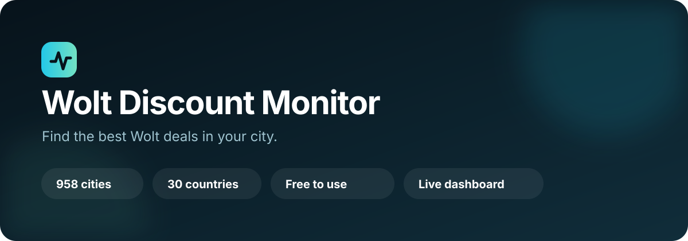
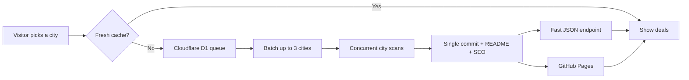

<div align="center">
  

  <br />

  **Find Wolt discounts worth ordering from — without checking venues one by one.**

  [**🍔 Open the free live dashboard →**](https://bl0ck154.github.io/wolt-discount-monitor/)

  [](https://github.com/Bl0ck154/wolt-discount-monitor/actions/workflows/test.yml)
  [](https://github.com/Bl0ck154/wolt-discount-monitor/actions/workflows/deploy-pages.yml)
  [](LICENSE)
  
  
  
</div>

> [!NOTE]
> Independent open-source project. Not affiliated with or endorsed by Wolt.

## A deal finder for people who actually use Wolt

Wolt can have a lot of promotions at the same time, but finding the useful ones often means opening venues one by one and scrolling past repeated delivery campaigns or discounts that only apply to selected products.

**Wolt Discount Monitor is a free public website built to make that easier.** It brings visible Wolt promotions into one searchable dashboard, ranks offers by estimated value, filters common noise, and lets you jump straight to a venue when you find something worth ordering.

**Nothing to install and no account required.** Open the site, search your city, and browse the deals.

### What you can do

- 🌍 Search a discovered catalog of **969 Wolt cities across 30 countries**.
- 🔥 See recently observed venue promotions and the last scan time.
- 📊 Sort deals by an estimated **0–100 value score**.
- 🔎 Search by venue, promotion, address, or category.
- 🧹 Hide likely account-restricted/new-customer campaigns, repeated citywide offers, and ordinary delivery offers.
- 🟢 Optionally hide venues marked closed at the last scan; this is not a live status.
- 🍕 Distinguish broad basket discounts from selected-item promotions.
- 🕒 Put venues marked open at the last scan first, with a reminder to confirm in Wolt.
- 📍 Open a venue on Wolt or view its location on the map.
- 🔗 Share the current city directly from the URL.
- ⭐ Save venues locally in this browser, without an account.
- 🌐 Browse in English, German, Lithuanian, Polish, or Czech.
- 📰 Subscribe to city RSS updates; feeds only include newly observed deals.
- 🧾 Estimate a checkout total using delivery/service fees shown by Wolt.
- 🗣️ Report incorrect offers through optional, prefilled GitHub Issues.

<!-- AUTO_COVERAGE_START -->
### Latest snapshot coverage

**30 cities with stored snapshots**, including **6 updated within 24 hours** as of 2026-11-12 00:01 UTC. The full catalog is much larger; catalog membership does not mean fresh deals are available.

| City | Last scan (UTC) | Ranked deal venues |
| --- | --- | ---: |
| [Bremen](https://bl0ck154.github.io/wolt-discount-monitor/?city=deu%2Fbremen) | 2026-11-12 00:01 | 78 |
| [Nuremberg](https://bl0ck154.github.io/wolt-discount-monitor/?city=deu%2Fnuremberg) | 2026-11-11 22:37 | 136 |
| [Vilnius](https://bl0ck154.github.io/wolt-discount-monitor/?city=ltu%2Fvilnius) | 2026-11-11 22:37 | 165 |
| [Prague](https://bl0ck154.github.io/wolt-discount-monitor/?city=cze%2Fprague) | 2026-11-11 15:17 | 445 |
| [Warsaw](https://bl0ck154.github.io/wolt-discount-monitor/?city=pol%2Fwarsaw) | 2026-11-11 15:16 | 37 |
| [Berlin](https://bl0ck154.github.io/wolt-discount-monitor/?city=deu%2Fberlin) | 2026-11-11 15:16 | 485 |
| [Oslo](https://bl0ck154.github.io/wolt-discount-monitor/?city=nor%2Foslo) | 2026-11-10 19:26 | 80 |
| [Vinkovci](https://bl0ck154.github.io/wolt-discount-monitor/?city=hrv%2Fvinkovci) | 2026-11-10 06:40 | 6 |
| [Mandal](https://bl0ck154.github.io/wolt-discount-monitor/?city=nor%2Fmandal) | 2026-11-08 10:13 | 0 |
| [Athens](https://bl0ck154.github.io/wolt-discount-monitor/?city=grc%2Fathens) | 2026-11-07 22:31 | 477 |

Offers are observed, not personalized. Check eligibility and the final delivery/service fees in Wolt.
<!-- AUTO_COVERAGE_END -->

## Use the dashboard

### **[Open Wolt Discount Monitor →](https://bl0ck154.github.io/wolt-discount-monitor/)**

1. Search for your city in the city picker.
2. Filter or search the available venues and promotions.
3. Sort by **Best discount** to bring stronger offers to the top.
4. Open the venue on Wolt when you find a deal you want.

The city picker searches the full discovered catalog. The public GitHub Pages deployment uses committed snapshots. When you pick a city without a recent snapshot, a Cloudflare coordinator queues just that city for a GitHub Actions scan. Other cities are not scanned automatically. Queued scans run one at a time to avoid losing jobs. New committed snapshots are served as soon as the GitHub scan commits, without waiting for the slower Pages redeploy; GitHub Pages remains the durable public copy. A mobile-friendly progress indicator shows the queued/dispatched/ready stages, queue position and elapsed wait without inventing a percent complete. Loading still depends on queue length and scan runtime. High but finite per-visitor and global daily limits protect the shared scanner. This avoids requiring a VPS or exposing an on-demand proxy to every site visitor.

## How deals are ranked

Raw promotion text is not very useful for comparing hundreds of venues, so the project normalizes offers into a shared **0–100 value score**.

The classifier distinguishes between:

- broad basket discounts;
- selected-item discounts;
- delivery discounts;
- new-user delivery campaigns;
- multibuy and perk-style offers.

The score is currency-independent, which keeps ranking behavior consistent across countries. Repeated chain locations and campaigns are also grouped where appropriate so one network-wide campaign does not overwhelm the results.

The same scoring logic is used by the website and the monitoring/notification pipeline.

Research notes and endpoint observations are documented in [`FINDINGS.md`](FINDINGS.md).

## What runs behind the website

The public dashboard is backed by an automated monitoring pipeline:

- discovers Wolt's public city catalog;
- fetches public venue and promotion data;
- normalizes and classifies promotions;
- assigns the 0–100 value score;
- stores per-city snapshots and cache metadata;
- detects appeared and ended campaigns;
- can send Telegram alerts for qualifying offers in the production monitor;
- deploys the website through GitHub Pages;
- batches up to **3 user-selected cities concurrently** in one GitHub Actions run;
- shows real queue/scanning/ready stages and elapsed wait time;
- keeps a local legacy Node API for separate development use.



The public site uses GitHub Pages for durable snapshots and a Cloudflare
Worker for user-triggered city refreshes. Only selected cities are scanned.
A fast endpoint makes a newly committed snapshot visible before Pages
redeploys. The optional Node API is local/legacy tooling.

[How batching, on-demand scanning and deployment work](cloudflare/wolt-city-refresh/README.md).

## Project structure

| Path | Purpose |
| --- | --- |
| `src/` | city discovery, Wolt requests, normalization, scoring, changes, API |
| `docs/` | public GitHub Pages dashboard |
| `docs/data/` | city catalog, snapshots, change history, notification state |
| `test/` | Node.js test suite |
| `.github/workflows/` | tests, monitoring, data compaction, Pages deployment |
| `scripts/` | operational dispatcher helpers |
| `cloudflare/wolt-city-refresh/` | D1 city queue, deployment and operations |
| `src/parallel-city-scans.mjs` | bounded 1–3 city asynchronous scans |

## Public Wolt endpoints used

```text
GET https://restaurant-api.wolt.com/v1/cities
GET https://consumer-api.wolt.com/v1/pages/venue-list/promotions-near-you?lon=<lon>&lat=<lat>
GET https://consumer-api.wolt.com/v1/pages/restaurants?lat=<lat>&lon=<lon>
```

Consumer API requests use:

```text
Platform: Web
```

## Run locally

**Requirements:** Node.js 20 or newer. The monitor uses Node.js built-ins and `undici` for proxy-enabled requests; see `package.json`.

```bash
git clone https://github.com/Bl0ck154/wolt-discount-monitor.git
cd wolt-discount-monitor
npm test
npm run cities
npm run check
```

Check one discovered city:

```bash
WOLT_CITY=<country-code>/<city-slug> node src/check-discounts.mjs
```

Check several cities (sequential by default):

```bash
WOLT_CITIES=ltu/vilnius,deu/nuremberg node src/check-discounts.mjs
```

For an explicit concurrent run, bounded to three cities:

```bash
WOLT_CITIES=ltu/vilnius,deu/nuremberg,deu/berlin WOLT_SCAN_CONCURRENCY=3 node src/check-discounts.mjs
```

Check the full discovered catalog:

```bash
WOLT_ALL_CITIES=true node src/check-discounts.mjs
```

Open `docs/index.html` locally. The committed `docs/config.js` contains an empty API origin, so the repository does not ship a private backend address.

## Data and caching

Important generated files include:

```text
docs/data/city-catalog.json
docs/data/cities.json
docs/data/latest.json
docs/data/changes.json
docs/data/changes-log.json
docs/data/notified-offers.json
docs/data/cities/<country-city-slug>/latest.json
docs/data/cities/<country-city-slug>/changes.json
docs/data/cities/<country-city-slug>/changes-log.json
```

Each city has its own cache. If a snapshot is newer than `WOLT_CACHE_TTL_HOURS`, the updater reuses it instead of calling Wolt again. The default is one hour. The live API deduplicates concurrent refreshes for the same city and serves a stale snapshot immediately while revalidating it in the background.

Different cities refresh through a bounded worker pool rather than one global serial queue. The default live-API concurrency is four cities, with a bounded waiting queue. Wolt's two city endpoints are spaced by a short configurable delay instead of the older fixed five-second pause.

Requests use timeouts and retry transient network failures, HTTP `429`, temporary invalid responses, and server-side `5xx` errors. Permanent client errors such as `404` are not retried.

Wolt transport is configurable with `WOLT_PROXY_MODE=direct-first|proxy-first|proxy-only` (default `direct-first`). When ProxyScrape is enabled, raw free-proxy addresses are never used blindly: the monitor probes candidates in parallel against a tiny Wolt consumer-API response, keeps a scored pool of healthy IPs, rotates requests across that pool, cools failed IPs, replenishes the pool in the background, and can persist the last healthy set for fast process restarts. `proxy-first` makes that checked pool the primary transport while still allowing direct access if the pool temporarily fails. ScraperAPI remains the managed final fallback when `SCRAPERAPI_API_KEY` is set. Proxy credentials and API keys are server secrets and must never be committed.

## Optional live API

The static dashboard can optionally use the included Node.js API:

```bash
npm run server
```

Available endpoints include:

```text
GET /health
GET /api/cities
GET /api/cities/<country>/<city>/latest
```

The API binds to loopback by default. Older releases injected a public HTTPS origin through `WOLT_API_BASE_URL`, but the production Pages workflow now explicitly publishes an empty API origin. The Node server can still run separately for development or other consumers; it is not part of the website's production data path.

See [`OPERATIONS.md`](OPERATIONS.md) for deployment and runtime configuration.

## Telegram notifications

Production alerts read credentials only from GitHub Actions secrets:

```text
TELEGRAM_BOT_TOKEN
TELEGRAM_CHAT_ID
```

If a qualifying alert is pending but credentials are unavailable, the updater fails before committing the new notification state. This avoids silently losing a deal notification.

Each Telegram alert names the city in a clickable heading linking to that city's public dashboard view. Generic Wolt acquisition-style banners (notably `5 € off (spend 12 €)` and `10 € off (spend 15 €)`) and explicit new-customer offers are omitted from Telegram alerts. The dashboard **hides them by default**, but the checkbox can reveal the raw observed Wolt banners. The anonymous feed cannot verify eligibility for an existing account. Hidden banners cannot determine the visible discount value or ranking; venues without visible offers are hidden by default. Alert identities are based on normalized venue and offer text rather than unstable internal campaign IDs; the notification-state reader migrates previous records automatically.

## Automation

The first daily scheduled scan also checks Berlin, Warsaw and Prague (best effort); other scheduled runs continue monitoring Vilnius and Nuremberg.

| Workflow | Purpose |
| --- | --- |
| [`test.yml`](.github/workflows/test.yml) | runs the Node.js test suite on relevant pushes and pull requests |
| [`check-discounts.yml`](.github/workflows/check-discounts.yml) | refreshes data, sends alerts, and commits generated changes |
| [`compact-data.yml`](.github/workflows/compact-data.yml) | keeps generated history manageable |
| [`deploy-pages.yml`](.github/workflows/deploy-pages.yml) | deploys the public dashboard |

The updater runs automatically five times daily on GitHub-hosted runners, independent of any VPS or self-hosted runner. If new data is committed, the same Actions run invokes the reusable Pages deployment. Manual `workflow_dispatch` runs use GitHub-hosted runners too. Scheduled checks refresh **Vilnius (`ltu/vilnius`) and Nuremberg (`deu/nuremberg`)** five times daily, while Telegram notifications are enabled for Vilnius and Nuremberg. Wolt requests use `SCRAPERAPI_API_KEY` as a fallback when direct access is rate-limited. [See Nuremberg deals](https://bl0ck154.github.io/wolt-discount-monitor/?city=deu%2Fnuremberg). Browsers never receive this key.

## Privacy and security

Anonymous pageview metrics are collected with Cloudflare Web Analytics. Explicit clicks to Wolt are recorded only as daily aggregate counts per city using a Cloudflare Worker; no destination URL, address, account ID, IP, basket amounts or persistent visitor ID is stored by the click counter. Saved venues remain in browser localStorage. The site needs no account; checkout estimates remain in your browser.


Secret values, Telegram chat IDs, private server addresses, private filesystem paths, and credentials must stay outside Git. The committed `docs/config.js` contains no backend address, and production Telegram credentials are referenced only through environment variables / GitHub Actions secrets.

For vulnerability reporting and the public/private deployment boundary, see [`SECURITY.md`](SECURITY.md).

## Keeping this README fresh

The coverage table is generated from committed city snapshots. The scheduled monitoring workflow calls syncCatalogStats() after collecting data and commits README counts with snapshots. Regenerate using npm run readme:sync; npm run readme:check detects outdated generated text against the same timestamp.

Edit descriptions and features normally. Do not manually change the text between AUTO_COVERAGE markers. The generator cannot know account-specific eligibility or address-dependent delivery fees.

## Contributing

Bug reports, edge cases from other cities, scoring improvements, and dashboard ideas are welcome. See [`CONTRIBUTING.md`](CONTRIBUTING.md) before opening a pull request.

If a Wolt response shape is not handled correctly, include only a **sanitized** example payload or the minimum structure needed to reproduce it.

## License

Released under the [`MIT License`](LICENSE).

---

<div align="center">
  <strong>Built to make Wolt promotions easier to discover and compare.</strong>
  <br /><br />
  <a href="https://bl0ck154.github.io/wolt-discount-monitor/"><strong>Open the dashboard</strong></a>
  ·
  <a href="https://github.com/Bl0ck154/wolt-discount-monitor/issues"><strong>Report an issue</strong></a>
</div>